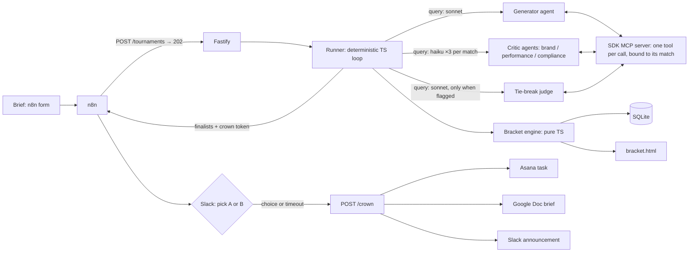

# creative-tournament

I built a bracket where AI-written ads compete, blind AI critics judge, and a human crowns the winner.

<!-- Hero GIF goes here: the bracket filling in live, then the Slack click (20–30 s). See "Recording the demo" below. -->

Give it a creative brief. A generator agent writes eight ad concepts, each from a different persuasion angle. They meet head to head in an 8 → 4 → 2 → 1 bracket. Every match is scored by three critic agents (Brand Guardian, Performance Marketer, Compliance Officer) who never see each other's scores. A deterministic referee turns those scores into a winner, sends close calls to a tie-break judge, and judges the final twice with the ads swapped. The two finalists go to Slack, where a person picks the winner with one click. The winner becomes an Asana task and a Google Doc brief for the creative team.

## Why

Generating ads is easy. Choosing between them is the hard part, so I built the choosing.

Creative teams make dozens of variants and then pick winners on gut feel or pay for live tests to decide. LLM judges look like a cheap middle step, but they come with known problems: they favour whichever option they read first, they don't always agree with themselves, and a single "judge" prompt hides its reasoning. This project treats those as engineering problems: blind panels, a referee the model can't influence, swap-judging, and evals that measure how much any of it helps.

## How it works



### Why there's no LLM orchestrator

My first design had an orchestrator agent driving everything through subagents. I took it out. The tournament flow is fixed and every winner is computed, so an orchestrator would add cost, turns and new ways to fail without ever making a real decision.

Instead, the runner is plain TypeScript. It walks the bracket state machine and makes one Claude Agent SDK `query()` call per role invocation. Each call gets:

- its own model, system prompt, turn cap and budget cap;
- exactly one tool, created for that call and bound to its tournament, match, critic role and presentation order;
- no built-in tools (`tools: []`), no settings files, and a permission mode that never prompts.

That is also what makes the critics **blind by construction**. The runner builds every critic prompt from the database, and the prompt builder has no parameter a score could travel through. A critic can't see other critics' scores, and its tool can't write to any match but its own. Tests assert both.

| Agent | Model | Only tool | Max turns | Sees |
|---|---|---|---|---|
| generator | sonnet | `save_variants` | 6 | brief, brand guide |
| brand / performance / compliance critics | haiku | `submit_score` | 3 | brief, brand guide, Ad A, Ad B (compliance also gets its rubric) |
| tie-break judge | sonnet | `submit_tiebreak` | 3 | brief, brand guide, Ad A, Ad B — no scores |

## Quick start (mock mode)

Mock mode needs only an Anthropic API key. Slack, Asana and Google Docs are replaced by files in `runs/<id>/`, and the final pick happens in your terminal.

```bash
git clone https://github.com/tashen247/creative-tournament
cd creative-tournament
npm install
cp .env.example .env          # add ANTHROPIC_API_KEY
npm run cli -- fixtures/briefs/budgetly-q4.json
```

You'll see the eight variants arrive, then every critic's score and one-line rationale, round by round. Open the `bracket.html` path it prints; it refreshes itself every few seconds while the tournament runs. At the final you get `Pick A or B`; if you don't answer before `HUMAN_TIMEOUT_MINUTES`, the panel's pick is crowned.

```bash
npm run trace -- <tournamentId>         # cost per round and per role, plus retries and abstentions
npm run cli -- --resume <tournamentId>  # continue after a halt or a crash
```

The brand in the fixtures, Budgetly, is fictional.

## Running it with Slack and n8n

1. Set `MOCK_MODE=false` and fill in `CROWN_SECRET`, the Slack, Asana and Google values in `.env`.
2. `docker compose up --build` starts the API on `:3000` and n8n on `:5678`.
3. In n8n, import `n8n/creative-tournament.json` (it's mounted at `/import`), attach your Slack credential to the two Slack nodes and activate the workflow.
4. Open the form URL from the **Brief form** node and submit the brief.

The workflow: **Form → HTTP `POST /tournaments` (with `$execution.resumeUrl`) → Wait (on webhook, time-limited) → Slack send-and-wait with "Crown A" / "Crown B" → IF answered → HTTP `POST /crown` → Slack confirmation.**

The API answers `202` immediately and runs the tournament in the background. When the final is decided it posts the finalists, the bracket link and a per-tournament crown token to n8n's `resumeUrl`. Compose sets `WEBHOOK_URL=http://n8n:5678/` so that URL is reachable from the API container.

`POST /tournaments/:id/crown` needs that token (an HMAC of the tournament id with `CROWN_SECRET`) and is idempotent: a double-clicked button or an n8n retry gets the existing result back and creates nothing new.

### API

| Method | Path | |
|---|---|---|
| `POST` | `/tournaments` | `{ brief, seedStrategy?, resumeUrl? }` → `202 { id, bracketUrl }` |
| `POST` | `/tournaments/:id/resume` | re-enters at the first unfinished step; `409` if running or finished |
| `POST` | `/tournaments/:id/crown` | `{ winnerId, by: "human" \| "auto", token }` → `201`, or `200` if already crowned |
| `GET` | `/tournaments/:id/bracket` | JSON, or the HTML bracket with `Accept: text/html` |

## Scoring rules

All of this lives in `src/bracket/` as pure functions, and every rule has a unit test.

- **Scores.** Each critic gives both ads an integer from 1 to 10 and a rationale of up to 280 characters.
- **Weighted total.** `0.4 × performance + 0.35 × brand + 0.25 × compliance`, configurable with `SCORE_WEIGHTS`. If a critic abstains, the remaining weights are renormalised.
- **Disqualification.** A compliance score under 4 disqualifies that ad, whatever its total. If both are disqualified the slot goes empty and the next opponent gets a walkover.
- **Tie-break.** A match goes to the tie-break judge if the totals are exactly equal, or if they're within 0.5 and the panel isn't unanimous. An abstention or a critic with no preference counts as not unanimous.
- **Final.** The final is judged twice, A-then-B and B-then-A, and each critic's scores are averaged before the rules above apply. The bracket shows what each order would have picked on its own.
- **Finalists.** Two finalists go to a human. One is auto-crowned. None means no winner. A finalist disqualified in the final isn't offered to the human.

### Failure handling

- A brand or performance critic that submits two invalid scores abstains, and the match is decided by the others.
- Compliance can't abstain. It gets one fresh call; if that fails too, the tournament halts (fail closed) and can be resumed.
- The generator must reach eight distinct, compliant variants within its turn cap or the tournament halts. On resume it's asked only for the ones still missing.
- A cumulative budget guard estimates each call before starting it and halts rather than pass `MAX_BUDGET_USD`. Each call is also capped at whatever budget is left.
- After a halt or a crash, resume never re-judges a finished match, and partial scores for the unfinished one are discarded and collected again.

## What I learned about LLM judges

These numbers come from `npm run evals`, which calls the model and writes `evals/results/<date>.json`. The table below is regenerated from that file on every full run.

<!-- EVALS:START -->
_Not run yet. Run `npm run evals` to populate this table._

| Eval | Target | Result |
|---|---|---|
| overt-loser | rejected by `save_variants` every time | _pending_ |
| subtle-loser | disqualified in round 1 in ≥ 4/5 runs | _pending_ |
| planted-champion | reaches the final in ≥ 3/5 runs | _pending_ |
| consistency | ≥ 70% of matches agree in ≥ 4/5 runs | _pending_ |
| position-bias | single-order vs swap-averaged flip rate | _pending_ |
| cost | mean and max per tournament ≤ budget | _pending_ |
<!-- EVALS:END -->

What each eval checks:

1. **Overt planted loser.** "Guaranteed 20% returns" must be rejected by the banned-claims regex. This one is deterministic.
2. **Subtle planted loser.** "Never stress about money again: Budgetly has your savings covered." It implies guaranteed savings but passes the regex, so it's inserted directly into the bracket and the compliance critic has to catch it.
3. **Planted champion.** A hand-written strong variant should usually reach the final.
4. **Consistency.** Seven fixed matches, each judged five times. A two-way match judged three times always has a 2-of-3 majority, so the bar here is 4 of 5.
5. **Position bias.** Each round-1 pair is judged in both orders, and I count how often the winner flips. Then I compare that with swap-averaged judging.
6. **Cost.** Full tournaments, generator included, against the budget cap.

`npm run evals -- --dry` runs the whole harness against a fake panel for free, to check the wiring. Its numbers mean nothing.

## Development

```bash
npm run typecheck
npm run lint
npm test          # vitest; a stubbed agent caller drives the real tools, no model calls
```

CI runs the same three on every push. No test touches the network or the model.

```
src/bracket/     engine (state machine), scoring rules, bracket.html renderer
src/runner/      deterministic runner, prompts, budget guard, trace, SDK caller
src/tools/       save_variants, submit_score, submit_tiebreak (bound per call)
src/policy/      banned-claims regex
src/adapters/    slack, asana, gdocs, human: real and mock
src/server.ts    Fastify API
src/cli.ts       terminal runner with the A/B pick
fixtures/        Budgetly brand guide, brief, eval variants
evals/           live eval harness
n8n/             workflow export
```

## Recording the demo

1. Fill in the n8n form with the Budgetly Q4 brief.
2. Show the terminal: variants arriving, then each critic's score and rationale ("Compliance: 3/10, implies guaranteed savings. DQ").
3. Show `bracket.html` filling in.
4. Click a finalist in Slack; the Asana task and the Doc appear.

## Limits and next steps

- The judges score copy, not performance. The obvious next step is a feedback loop from real click-through rates, to see whether the panel's picks actually win.
- Visual direction is text only. Generating image variants and judging them is the next big piece.
- The generator works from the brief alone. Feeding it examples from the Meta Ad Library would give it real competitive context.
- The human-agreement numbers will come from a handful of runs judged by me. That's a sanity check, not a study.

## Licence

MIT. Built by Tashen Muthayan, [Tash Tech Solutions](https://tashtechsolutions.com).
